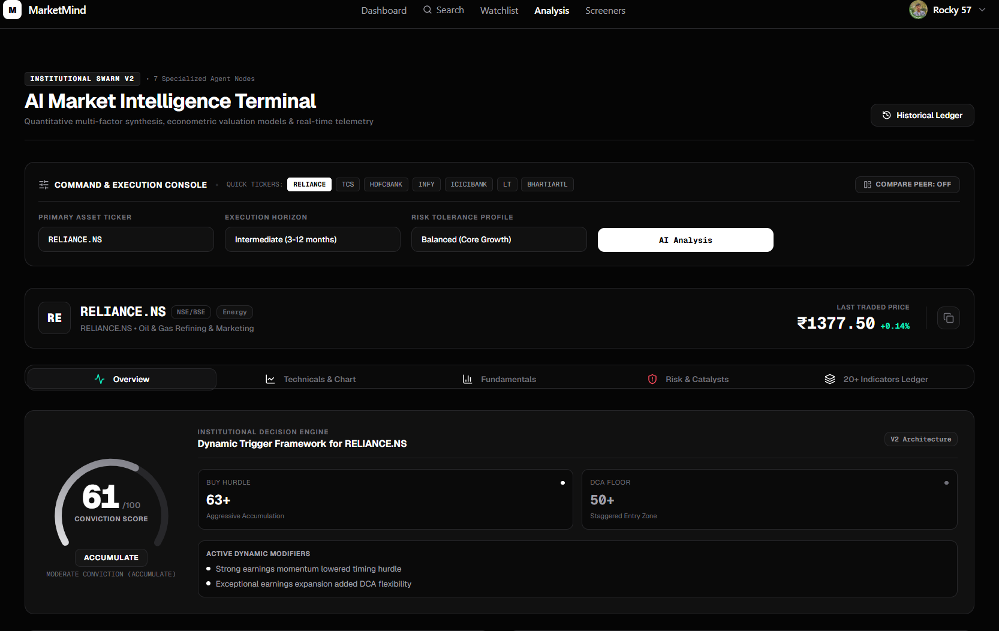
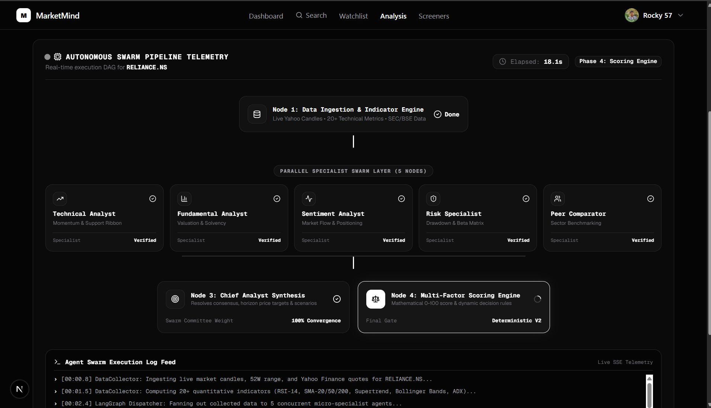
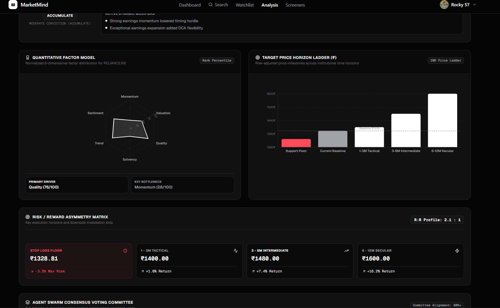
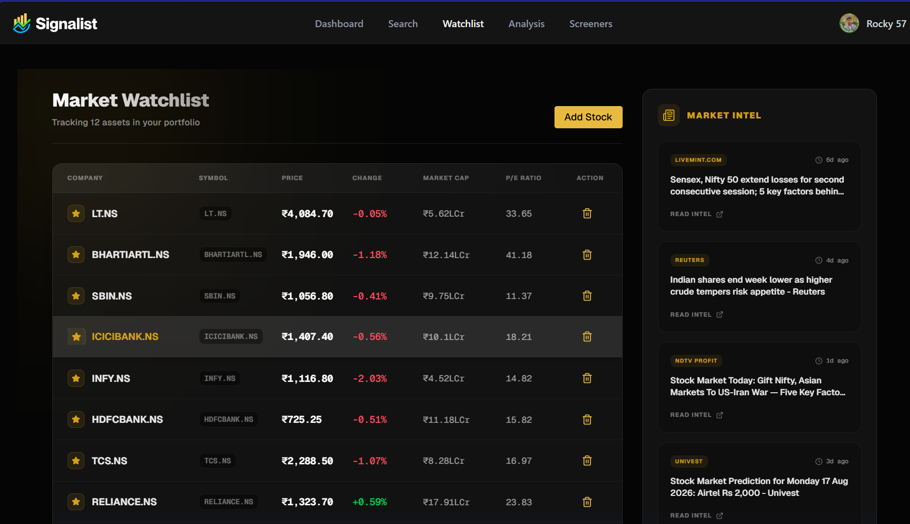
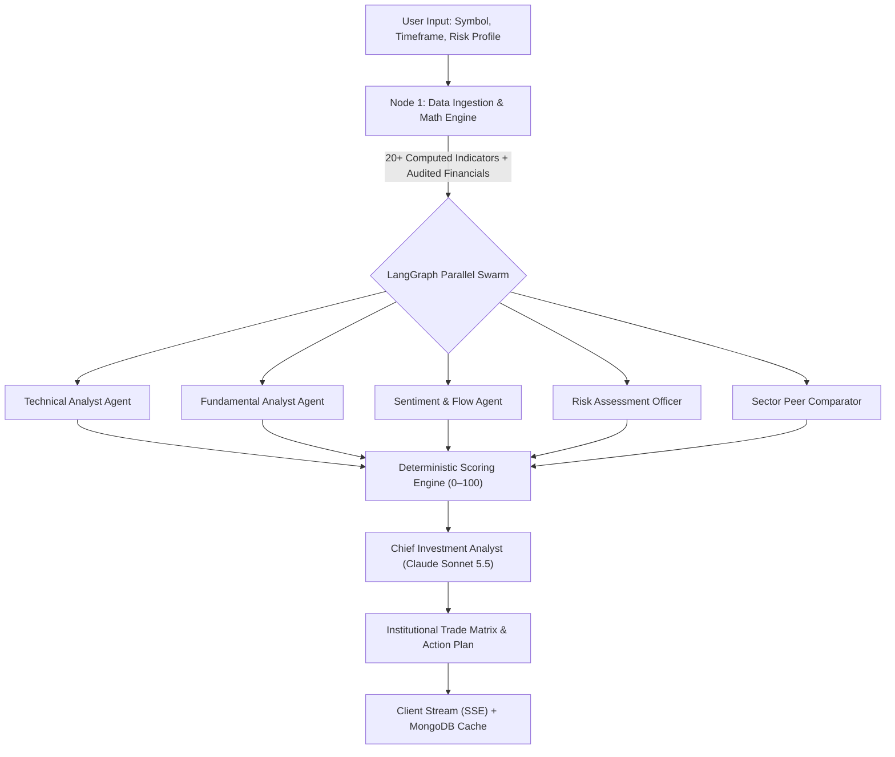

# MarketMind — AI-Agentic Stock Intelligence Terminal

An institutional-grade, multi-agent quantitative market intelligence terminal and stock analysis platform. Built with **Next.js (App Router)**, **TypeScript**, **Tailwind CSS**, **MongoDB**, **LangGraph**, and powered by **Anthropic Claude Sonnet 5.5**. 🚀

MarketMind bridges the gap between raw quantitative market telemetry and cognitive AI reasoning. Instead of treating LLMs as calculators or relying on single monolithic prompts, MarketMind computes **20+ mathematical indicators deterministically** from live market data feeds and orchestrates an autonomous swarm of **5 specialized research agents** in a directed acyclic graph (DAG) via LangGraph to produce institutional-grade investment reports.

[](https://nextjs.org/)
[](https://www.typescriptlang.org/)
[](https://github.com/langchain-ai/langgraphjs)
[](https://www.anthropic.com/)
[](https://tailwindcss.com/)
[](https://www.mongodb.com/)

---

## 🖼️ Visuals & Platform Showcase

Curated screenshots showcasing the key interfaces, multi-agent workflows, and quantitative visualizations of the MarketMind terminal:

### 1. Main Dashboard & Market Telemetry

*Real-time global market overview featuring interactive TickerTape, Stock Heatmap, and live market quotes.*

---

### 2. AI Market Intelligence Terminal & Command Console

*Institutional analysis console featuring primary asset selection, execution horizon controls, risk profile customization, real-time price quotes, and comprehensive executive synthesis.*

---

### 3. Autonomous Multi-Agent Swarm in Execution

*Live LangGraph DAG pipeline execution showing active node states across all 5 specialist agents (Technical, Fundamental, Sentiment, Risk, Peer Comparator) with real-time streaming progress logs.*

---

### 4. Institutional Quantitative Visualizations & Factor Models

*Advanced visual analytics including Multi-Horizon Target Price Trajectory, Moving Average Extension Channels, Multi-Factor Radar Matrix, Conviction Gauge, and Sector Valuation Benchmarking.*

---

### 5. Detailed Stock Research & Interactive Charts

*Detailed single-stock view integrating TradingView advanced candlestick charting, technical summary gauges, corporate profile, and audited financials.*

---

### 6. Institutional Stock Screener

*Institutional multi-parameter stock screener tracking 5,000+ Indian (NSE/BSE) and global equities with live sorting across market cap, volume, and valuation.*

---

### 7. Persistent Portfolio Watchlist

*Custom user watchlists backed by MongoDB with live pricing updates, quick actions, and targeted financial news feeds.*

---

### 8. Command Palette & Global Search

*Instant symbol search and command palette supporting Indian equities (NSE/BSE) and global tickers.*

---

### 9. Authentication & Secure Onboarding

*Dark luxury authentication UI powered by Better Auth with cookie-based session management.*

---

## 🏛️ System Architecture (Engine V2)



---

## ⚡ Key Highlights & Capabilities

### 1. Zero-Hallucination Quantitative Math Engine
In high-stakes financial analysis, LLMs cannot be trusted with arithmetic. MarketMind decouples quantitative calculations from cognitive synthesis. The backend computes **20+ mathematical indicators** directly from 180–240 days of historical daily OHLCV trading bars:
* **Trend & Structure:** SMA (20, 50, 200), EMA (12, 26), ADX (14) trend strength, Supertrend (ATR-based dynamic floor).
* **Momentum & Divergence:** RSI (14), MACD (12, 26, 9 Line, Signal, Histogram), Stochastic Oscillator (%K, %D), Williams %R.
* **Volatility & Risk Channels:** Average True Range (ATR 14), Bollinger Bands (Upper, Middle, Lower, %B bandwidth), Keltner Channels, Annualized Volatility %.
* **Volume & Institutional Flow:** On-Balance Volume (OBV), Volume Weighted Average Price (VWAP), Money Flow Index (MFI), Volume Velocity Trend.
* **Fundamental Audits:** Trailing & Forward P/E, Price-to-Book (P/B), Return on Equity (ROE), Debt-to-Equity, Net Margin, Operating Margin, Revenue Growth YoY, Earnings Growth YoY, and Free Cash Flow.

### 2. Autonomous Multi-Agent Swarm (LangGraph)
Rather than executing a single generic prompt, MarketMind decomposes the evaluation across 5 parallel research tracks:
* **Technical Analyst (`technical-analyst.ts`):** Evaluates trend regimes (`TRENDING_UP`, `TRENDING_DOWN`, `RANGING`, `VOLATILE`), institutional support/resistance anchors, and momentum divergences.
* **Fundamental Analyst (`fundamental-analyst.ts`):** Evaluates multiples against sector peer cohorts, assigns profitability quality grades (`A` through `F`), and audits balance-sheet solvency.
* **Sentiment & Liquidity Analyst (`sentiment-analyst.ts`):** Ingests Money Flow Index and volume structures to detect whether smart money is accumulating or distributing shares.
* **Risk Officer (`risk-analyst.ts`):** Stress-tests business risk, multiple contraction sensitivity, beta risk, and macroeconomic headwinds.
* **Sector Peer Comparator (`peer-comparator.ts`):** Benchmarks the asset against top industry competitors (e.g., comparing `LT.NS` against `SIEMENS`, `ABB`, `HAL`, and `BEL`) on relative valuation and price performance.

### 3. Chief Analyst Synthesis (Claude Sonnet 5.5)
All verified mathematical facts, specialist agent outputs, and peer data are ingested by **Claude Sonnet 5.5** acting as the Chief Investment Officer. It synthesizes:
* **Executive Summary:** Comprehensive multi-factor investment thesis.
* **Target Price Horizon Ladder:** Timeframe-adjusted price targets (1–3 Months, 3–6 Months, 6–12 Months).
* **Asymmetric Risk Framework:** Clear upside bull case vs. strict bear case invalidation floor.
* **Institutional Action Plan:** Recommended staggered accumulation price zones and systematic stop-loss levels.
* **Monitoring Checklist & Upcoming Catalysts:** Key events, earnings dates, and technical triggers to track.

### 4. Deterministic Conviction Scoring Framework
To prevent arbitrary AI score drift, a weighted deterministic formula calculates the **Conviction Score (0–100)**:
$$\text{Final Score} = (\text{Technical} \times 0.40) + (\text{Fundamental} \times 0.40) + (\text{Sentiment \& Risk} \times 0.20)$$
The result is dynamically calibrated against the investor's selected **Execution Horizon** (Short, Medium, Long) and **Risk Profile** (Conservative, Balanced, Aggressive) to produce unambiguous decisions: `STRONG_BUY`, `ACCUMULATE`, `NEUTRAL`, `TRIM`, or `EXIT`.

### 5. Premium Dark Luxury Monochrome UI/UX
Designed with a black-dominant, high-end SaaS minimalist aesthetic:
* **Color Palette:** `#050505` primary canvas, `#0A0A0A` secondary canvas, `#111111` card surfaces, `#27272A` subtle borders, `#FFFFFF` high-contrast typography, and `#71717A` muted metadata.
* **Live Pipeline DAG Flowchart:** An interactive flowchart visualizing agent node execution states in real-time, accompanied by a streaming SSE terminal execution feed.
* **Institutional Charts & Data Visuals:** Recharts Moving Average Extension Chart, Target Price Trajectory Ladder, Conviction Gauge, Sector Valuation Benchmark Bar, and Factor Radar Chart.

### 6. Seamless TradingView Integrations
* **Symbol Profile Widget:** Live corporate background, sector, and industry data via TradingView's official `embed-widget-symbol-profile.js`.
* **Audited Financial Statements:** Integrated TradingView financials widget (`financials.js`) for balance sheet, income statement, and cash flow history.
* **Stock Screener:** Fully responsive stock screener widget (`embed-widget-screener.js`) tracking 5,000+ Indian (NSE/BSE) and global equities.
* **Advanced Candlestick Charts & Technical Gauges:** Interactive TradingView charting with multi-interval indicators.

### 7. Production-Ready Resilience & Performance
* **Zod Schema Validation:** Every agent output is strictly validated against schemas in `lib/engine/schemas.ts`.
* **Graceful Mathematical Fallback:** If external LLM APIs experience rate limits, the system automatically runs deterministic quantitative fallbacks so reports always render.
* **Tiered MongoDB Caching:** 1-hour TTL caching prevents redundant API charges on repeat ticker queries, while the **Start Analysis** action bypasses cache on demand.

---

## 🛠️ Tech Stack

### Frontend & UI
* **Framework:** Next.js 16 (App Router)
* **Language:** TypeScript 5.0
* **Styling:** Tailwind CSS (Custom Dark Luxury Monochrome Tokens)
* **Components:** Radix UI primitives, Lucide Icons, Sonner toasts
* **Data Visualization:** Recharts, TradingView Embed Widgets

### AI & Agentic Engine
* **Orchestration:** LangGraph (`@langchain/langgraph`)
* **Primary LLM:** Anthropic Claude Sonnet 5.5 (via native HTTP streaming client)
* **Secondary LLM:** Google Gemini (`@langchain/google-genai`), OpenAI, Groq
* **Schema Validation:** Zod

### Backend & Database
* **Runtime:** Node.js (Next.js Edge & Node Server Functions)
* **Database:** MongoDB Atlas via Mongoose
* **Authentication:** Better Auth (`better-auth`) with secure session handling
* **Financial APIs:** Yahoo Finance (`yahoo-finance2`), Google News RSS

---

## 📁 Directory Structure

```text
├── app/
│   ├── (auth)/                  # Sign-in and sign-up pages
│   ├── (root)/
│   │   ├── analysis/            # AI Intelligence Terminal & Swarm Flowchart
│   │   ├── screeners/           # Institutional Stock Screener
│   │   ├── stocks/[symbol]/     # Individual stock details & charts
│   │   ├── watchlist/           # User persistent watchlist
│   │   └── page.tsx             # Main dashboard (Heatmap, Market Quotes)
│   ├── api/
│   │   ├── stock-analysis/      # SSE streaming endpoint for multi-agent graph
│   │   ├── news/                # Financial news aggregation route
│   │   └── watchlist/           # Watchlist management API
│   └── globals.css              # Global dark luxury monochrome design tokens
├── components/                  # Reusable UI & TradingView widgets
├── database/                    # Mongoose connection & MongoDB models
├── hooks/                       # Custom hooks (TradingView widget loader, debounce)
└── lib/
    ├── actions/                 # Server actions (stocks, news, watchlist, analysis)
    └── engine/                  # MarketMind Engine V2 Core
        ├── agents/              # 5 Specialist agents + Chief analyst
        ├── indicators/          # 20+ pure mathematical indicator formulas
        ├── infra/               # LLM provider (Claude Sonnet), rate limiter, cache
        ├── graph.ts             # LangGraph DAG workflow definition
        ├── scoring.ts           # Deterministic multi-factor scoring algorithm
        ├── schemas.ts           # Zod output validation schemas
        └── types.ts             # Shared TypeScript interfaces
```

---

## 🚀 Getting Started

### Prerequisites
* **Node.js:** v18.0.0 or higher
* **Package Manager:** npm or pnpm
* **MongoDB:** A running MongoDB Atlas cluster or local MongoDB instance

### 1. Clone & Install

```bash
git clone https://github.com/your-username/MarketMind-AI-Agentic-Stock-Analysis-Platform.git
cd MarketMind-AI-Agentic-Stock-Analysis-Platform
npm install
```

### 2. Environment Configuration

Create a `.env` file in the root directory:

```env
# MongoDB Connection String
MONGODB_URI=mongodb+srv://<username>:<password>@cluster.mongodb.net/marketmind

# Better Auth Configuration
BETTER_AUTH_SECRET=your_super_secret_session_key
BETTER_AUTH_URL=http://localhost:3000

# Anthropic Claude API Configuration
ANTHROPIC_API_KEY=your_anthropic_api_key_here
CLAUDE_MODEL=claude-sonnet-5-5

# Optional: Google Gemini / OpenAI / Groq (Fallbacks)
# GEMINI_API_KEY=your_gemini_api_key
# OPENAI_API_KEY=your_openai_api_key
# GROQ_API_KEY=your_groq_api_key

# Financial Market APIs
FINNHUB_API_KEY=your_finnhub_key_here
TWELVE_DATA_API_KEY=your_twelve_data_key_here
NEXT_PUBLIC_GNEWS_API_KEY=your_gnews_key_here

# Environment Mode
NODE_ENV=development
```

### 3. Run Development Server

```bash
npm run dev
```

Open [http://localhost:3000](http://localhost:3000) in your browser.

### 4. Build for Production

```bash
npm run build
npm start
```

---

## 🧪 Testing the Multi-Agent Pipeline

To test the multi-agent graph directly via cURL:

```bash
curl -X POST http://localhost:3000/api/stock-analysis \
  -H "Content-Type: application/json" \
  -d '{
    "symbol": "RELIANCE.NS",
    "timeframe": "medium",
    "riskProfile": "balanced",
    "forceRefresh": true
  }'
```

The endpoint will return a Server-Sent Events (SSE) stream broadcasting:
1. `step`: Agent node execution updates (DataCollector $\to$ TechnicalAnalyst $\to$ FundamentalAnalyst $\to$ SentimentAnalyst $\to$ RiskAnalyst $\to$ PeerComparator $\to$ ChiefAnalyst).
2. `stockData`: Quantitative indicator snapshot.
3. `token`: Complete institutional analysis JSON payload.

---

## 📈 Roadmap

- [x] Engine V2: 5-Agent parallel DAG architecture with LangGraph.
- [x] Zero-hallucination mathematical indicator calculation engine (20+ indicators).
- [x] Claude Sonnet 5.5 integration with token telemetry logging.
- [x] Premium dark luxury monochrome aesthetic.
- [x] Real-time SSE flowchart DAG progress visualization.
- [ ] Portfolio risk simulation and VaR (Value at Risk) stress-testing.
- [ ] Automated scheduled morning market briefings.
- [ ] Multi-asset coverage (Crypto, Forex, US Equities).

---

## 📄 License

This project is licensed under the MIT License.
